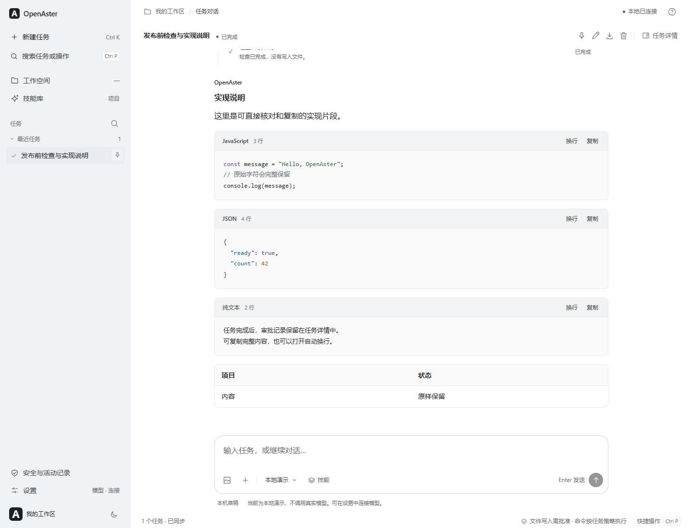

# OpenAster

一个可以连接自己的模型、读写项目文件并运行命令的开源智能体工作台。浏览器、桌面应用和移动客户端使用同一套任务界面。

OpenAster 通过 **Vibe Coding** 开发：使用自然语言与 AI 编程工具迭代实现，再检查代码和运行测试。它是个人学习与探索项目，当前版本为 **0.2.3 预览版**。

[上手教程](docs/TUTORIAL.md) · [使用说明](docs/GETTING_STARTED.md) · [下载与平台状态](docs/PLATFORMS.md) · [开发指南](docs/DEVELOPMENT.md)



图：本地合成数据演示，展示代码、文本块与表格，不含真实账号或私人项目。

## 能做什么

- 连接 OpenAI 兼容接口、Responses、Anthropic 或 Ollama；支持文本、图片和工具调用，具体能力取决于模型。
- 在对话中查看执行过程、命令结果和文件修改；模型返回公开思考内容时，可以展开阅读。
- 创建和切换项目，浏览、搜索和编辑工作区文件。
- 执行中继续补充消息，或打断后发送新要求；草稿和图片在接受后才清空。
- 选择命令审批方式，也可以随时撤销本轮任务的命令授权。
- 使用内置 Skills，或在项目中维护自己的技能说明。
- 开启联网后搜索公开网页、读取正文，并在任务中保留可核对的来源链接。
- 为长任务设置输出和调用预算；接近上下文窗口时自动整理早期记录，纯文本达到输出上限时继续生成。

联网默认关闭。启用后，搜索默认通过 [Parallel 官方 MCP](https://docs.parallel.ai/integrations/mcp/quickstart) 免密钥调用，有限流，也不保证第三方服务始终可用。设置中可明确选择百炼原生搜索或实验性 DuckDuckGo 网页入口；百炼使用当前 Qwen 连接，会额外产生模型与搜索费用，自定义兼容地址是否支持该接口尚未实测。程序不会自动改地址或切换搜索服务。

搜索服务选择只在当前后端进程有效，重启恢复 Parallel，任务运行中不能更改。验证码或限流等失败会停止本轮重复搜索，仍可按网页访问规则读取已知公开地址；`curl` 能读取已知 URL，但不提供搜索索引，也不能解决验证码。配置与限制见[搜索与阅读网页](docs/GETTING_STARTED.md#搜索与阅读网页)。

## 在电脑上运行网页版

网页版需要一个本地 Node.js 服务。关闭终端或停止服务后，浏览器便不能继续执行任务。

### 1. 安装环境

安装 [Node.js 24](https://nodejs.org/en/download)，然后打开终端检查：

```sh
node --version
npm --version
```

`node --version` 应显示 `v24` 开头的版本。安装项目使用的包管理器：

```sh
npm install --global pnpm@11.25.0
pnpm --version
```

### 2. 取得源码

安装了 Git 的用户可以执行：

```sh
git clone https://github.com/yanghaitao1995/OpenAster.git
cd OpenAster
```

也可以在仓库页面选择 **Code → Download ZIP**，解压后在包含 `package.json` 的目录打开终端。不要直接在压缩包里运行。

### 3. 安装依赖并启动

以下命令在 Windows PowerShell、macOS 终端和 Linux 终端中相同：

```sh
pnpm install --frozen-lockfile
pnpm start
```

看到服务启动提示后，打开 [http://127.0.0.1:4317/](http://127.0.0.1:4317/)。第一次可以保留“本地演示”模型，先熟悉界面；演示任务不消耗模型额度。

安装依赖时需要联网。`--frozen-lockfile` 表示严格使用仓库锁定的依赖版本；安装失败时先核对 Node.js、pnpm 和网络，不要直接删除锁文件。

### 4. 选择自己的项目

进入**工作空间**，点击**新建项目**，输入名称后选择**新建并打开**。也可以点击**打开项目**，从最近项目、主机目录或本机完整路径中选择。界面会显示项目的实际路径。

默认新项目放在用户主目录下的 `OpenAster Projects`。项目执行中、文件未保存或草稿尚未写入时，需要先处理这些状态再切换。不同项目分别保存会话和模型连接。

本机浏览器管理的是这台电脑上的目录。手机或其他电脑连接网关后，管理的是**网关主机**上的项目；切换设备不会把文件自动复制到新设备。

### 5. 连接真实模型

在**设置 → 添加模型**中填写服务商地址、协议、模型标识和 API 密钥。先用“只回复 OK”确认连接，再尝试图片或工具任务。不要把密钥填写到任务消息中。

网页服务中临时输入的密钥只在当前服务进程内保存。桌面应用可使用系统提供的凭据保护。具体配置见[使用说明](docs/GETTING_STARTED.md)。

长任务可在模型设置中展开**输出与上下文**和**长任务预算**。新连接默认每次输出 16,384 token，每轮任务最多 64 次主对话模型请求、256 次工具操作；已有连接的显式输出设置会保留。请按服务商实际规格填写上下文窗口和输出上限，调高应用设置不能突破模型自身限制。操作步骤见[长任务与上下文](docs/GETTING_STARTED.md#长任务与上下文)。

### 6. 停止、重启与更新

在启动服务的终端按 `Ctrl+C` 停止；下次仍在项目根目录执行 `pnpm start`。更新源码前先停止服务并备份数据，再重新安装依赖。

默认应用数据位于项目根目录下的 `.openaster/`，默认工作区为其中的 `workspace/`。会话数据和项目文件是两类不同的数据；卸载源码或清理目录前请分别核对。

## 常用启动设置

| 环境变量 | 用途 | 默认值 |
| --- | --- | --- |
| `PORT` | 网页服务端口 | `4317` |
| `OPENASTER_DATA_DIR` | 会话、设置与项目登记数据目录 | 项目根目录下的 `.openaster` |
| `OPENASTER_WORKSPACE` | 首次启动的默认工作区 | 数据目录下的 `workspace` |
| `OPENASTER_PROJECTS_ROOT` | 新建项目的主机目录 | 用户主目录下的 `OpenAster Projects` |

例如临时换用 4320 端口：

Windows PowerShell：

```powershell
$env:PORT = '4320'
pnpm start
```

macOS / Linux：

```sh
PORT=4320 pnpm start
```

自定义目录时使用绝对路径。不要让多个服务同时写入同一数据目录。面向手机的 HTTPS 网关配置见[使用说明](docs/GETTING_STARTED.md)；默认启动方式供本机使用。

## 安装包

0.2.3 的安装文件、SHA-256、签名状态和逐项验证结果见 [版本下载页](https://github.com/yanghaitao1995/OpenAster/releases/tag/v0.2.3)。桌面文件按 Windows x64、macOS arm64 和 Linux x86_64 / amd64 区分，Android 提供调试 APK；只下载对应系统与架构的实际附件，没有列出的包表示尚未提供。各平台条件及 Android 调试签名的升级限制见[平台说明](docs/PLATFORMS.md)。当前不提供可在 iPhone 上直接安装的 IPA 或 TestFlight 邀请。

## 仓库结构

| 目录 | 内容 |
| --- | --- |
| `core/` | 模型协议、任务循环、工具和访问规则 |
| `server/` | HTTP 服务、项目管理、认证与数据存储 |
| `public/` | 各客户端共用的界面与样式 |
| `desktop/` | Electron 主进程、系统菜单和桌面打包 |
| `mobile/` | Capacitor 外壳与原生项目生成 |
| `skills/` | 内置技能 |
| `config/` | 公开源码发布清单 |
| `tests/`、`scripts/` | 验证、构建和维护工具 |

设计与边界见[架构说明](ARCHITECTURE.md)。依赖、工具链、用户数据、生成的原生工程和历史诊断不纳入公开源码。

## 使用前需要知道

这是 Vibe Coding 学习项目的预览版，按 [Apache License 2.0 原文](LICENSE)以“现状”提供，不承诺无错误、绝对安全或适合特定用途；法律不允许排除或限制的责任不因此排除或限制。本说明不改变许可证条款。

使用前备份数据，核验 AI 输出，并确认模型、搜索服务的费用及资料发送范围。命令使用主机当前账户权限，审批不构成操作系统沙箱。网页部署、各平台签名和安装限制请先阅读[完整使用前说明](docs/PLATFORMS.md#使用前说明)。

问题反馈使用仓库的 Issue 模板；安全问题按 [SECURITY.md](SECURITY.md) 处理。参与修改请阅读 [CONTRIBUTING.md](CONTRIBUTING.md)。

## 许可

源码采用 [Apache License 2.0](LICENSE)。第三方组件保留各自许可证，见 [NOTICE](NOTICE) 和[第三方说明](docs/THIRD_PARTY.md)。个人学习项目的定位不增加非商业使用限制。
