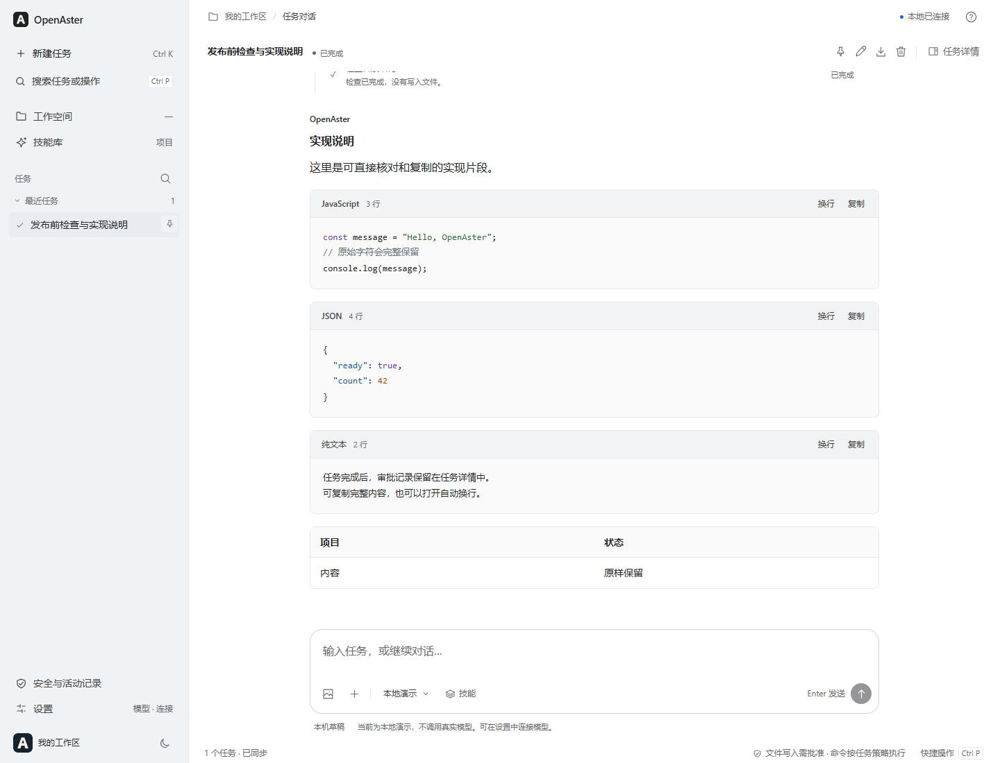

# 从一条消息到一次工具执行：用 OpenAster 学习桌面 Agent 开发

在对话框里输入“帮我整理这个项目”，模型可以给出一份建议。但要让它真的查看目录、读取文件、修改代码，再把结果展示出来，还需要一套负责执行的程序。本文用 OpenAster 走一遍这条路径。

OpenAster 是一个采用 **Vibe Coding** 方式开发的开源学习项目。这里的 Vibe Coding，指通过自然语言描述需求，由 AI 辅助编写和修改代码，再通过阅读源码、运行程序和测试来确认结果。它适合用于学习与探索，当前版本为 0.2.3 预览版。

源码：[github.com/yanghaitao1995/OpenAster](https://github.com/yanghaitao1995/OpenAster)。本文的示例代码与讲解按这个项目重新编写，示例不会读取个人文件，也不需要模型账号。



图：本地合成数据演示，展示实际界面的代码块和表格；没有使用私人会话或模型账户信息。

## 开始前的说明

这是 Vibe Coding 学习项目的预览版，依据 [Apache License 2.0 原文](https://github.com/yanghaitao1995/OpenAster/blob/main/LICENSE)以“现状”提供，不保证没有错误、绝对安全或适合特定用途；法律不允许排除或限制的责任不因此排除或限制。这段说明不改变许可证。练习前先备份重要数据，核验 AI 生成的代码、答案和来源。命令使用服务主机当前账户的权限，界面中的审批与项目目录不是操作系统沙箱。

真实模型和搜索可能产生第三方费用；对话、已发送图片、任务所用文件内容及工具结果可能交给模型，搜索词会交给所选搜索服务。不要提交无权使用的资料或把密钥写入任务。本文的本地练习无需这些服务；远程使用网页版或手机客户端时，仍须配置可信 HTTPS 网关与认证。

安装包以对应 [Release](https://github.com/yanghaitao1995/OpenAster/releases) 的实际附件为准，核对系统、架构、SHA-256 与签名说明，不绕过系统或证书警告。Windows 预览包未作发布者代码签名，macOS 预览构建未公证，Android 调试包不是商店正式版。当前没有可直接安装到 iPhone 的 IPA；模拟器 `.app` 不能替代真机包，iPhone 可通过受信任 HTTPS 网关在 Safari 使用网页版。各平台的完整条件见[平台说明](https://github.com/yanghaitao1995/OpenAster/blob/main/docs/PLATFORMS.md)。

## 1. Agent 到底多做了什么

先看一个很小的任务：

```text
买 3 个笔记本，每个 12 元，一共多少钱？
```

普通聊天可以直接回答“36 元”。如果规定模型必须调用计算工具，过程就变成：

1. 模型提出请求：调用乘法工具，参数是 3 和 12。
2. 程序检查：工具存在吗？两个参数都是数字吗？
3. 程序执行乘法，得到 36。
4. 程序把 36 交回模型。
5. 模型组织成一句话，显示给用户。

算式仍然只有 `3 × 12 = 36`。多出来的是“提出操作—检查—执行—反馈”这个循环。把乘法换成读文件、查目录或运行测试，循环的形状没有变，只是操作的影响更大了。

这也解释了一个容易混淆的现象：模型说“已经运行测试”，并不能证明测试真的执行过。程序需要保存工具请求、开始时间、退出状态和输出，才能回答“执行了什么、结果是什么”。

## 2. 先让项目在自己的电脑上运行

第一次学习建议使用网页版。它与桌面端共用任务界面，也便于打开浏览器开发者工具观察请求。

### 2.1 准备 Node.js 和 pnpm

Node.js 用来运行 JavaScript 服务。浏览器负责画页面，Node.js 负责接收任务、调用模型和执行工具。

安装 [Node.js 24](https://nodejs.org/en/download) 后，打开终端。Windows 可以使用 PowerShell；macOS、Linux 使用各自的终端。输入：

```sh
node --version
npm --version
```

第一条应显示 `v24` 开头的版本。`npm` 随 Node.js 提供，用它安装项目指定的包管理工具：

```sh
npm install --global pnpm@11.25.0
pnpm --version
```

包管理工具的作用是读取项目的依赖清单，把需要的库安装到 `node_modules`。仓库中的 `pnpm-lock.yaml` 记录了具体版本，防止不同电脑随意拿到不同依赖。

### 2.2 下载、安装、启动

在 GitHub 仓库点击 **Code → Download ZIP**，解压后进入包含 `package.json` 的目录。有 Git 的读者也可以执行：

```sh
git clone https://github.com/yanghaitao1995/OpenAster.git
cd OpenAster
```

接着运行：

```sh
pnpm install --frozen-lockfile
pnpm start
```

`--frozen-lockfile` 表示按现有锁文件安装，不自行改动依赖解析结果。

终端保持打开，在浏览器访问：

```text
http://127.0.0.1:4317
```

`127.0.0.1` 指这台电脑自己；`4317` 是本地服务监听的端口。关闭服务时，在启动它的终端按 `Ctrl+C`。

如果 4317 已被占用，Windows PowerShell 可以这样换端口：

```powershell
$env:PORT = '4320'
pnpm start
```

macOS、Linux 对应的写法是：

```sh
PORT=4320 pnpm start
```

然后访问 `http://127.0.0.1:4320`。PowerShell 的环境变量影响当前终端及它后续启动的进程，关闭该终端后结束；这里不修改系统 PATH。

### 2.3 创建练习目录

在界面中点击 **工作空间 → 新建项目**，选择父目录，输入 `agent-practice`，点击 **新建并打开**。界面会显示实际目录；已有文件夹可通过 **打开项目** 选择。

先选择演示模式，发送一条短消息。演示模式使用固定的本地行为，适合观察界面，不用于评价模型效果。

需要真实模型时，在设置中选择协议，填写自己服务商提供的地址、模型名和密钥，先用“只回复 OK”检查连接。密钥填在配置入口，不要写进对话或源代码。成功返回一次短文本，只能说明这次连接成功，图片和工具能力仍需分别确认。

## 3. 看目录时，先找这六个位置

初次打开一个项目，不必从第一行读到最后一行。可以先按一次请求经过的顺序定位代码。

| 目录 | 负责的事情 | 第一次阅读时关注什么 |
| --- | --- | --- |
| `public/` | 页面、输入框、消息和过程展示 | 点击发送后调用了什么接口 |
| `server/` | HTTP 接口、认证、存储和项目切换 | 请求如何进入运行时 |
| `core/` | 模型适配、任务循环、工具与权限 | 模型返回工具请求后如何执行 |
| `desktop/` | Electron 窗口和系统集成 | 如何启动服务并打开窗口 |
| `mobile/` | 手机伴侣和原生工程准备 | 如何复用界面并连接主机 |
| `tests/` | 自动化测试 | 正常流程之外还检查了什么 |

一条消息大致经过：

```text
输入框 → HTTP 接口 → 任务运行时 → 模型适配器
                         ↓            ↑
                       工具执行 ── 工具结果
                         ↓
                    保存状态与推送事件
                         ↓
                       更新页面
```

前端不需要知道某个模型服务的每一种字段；它主要关心任务状态和展示数据。不同服务的协议差异留在适配器中处理。这种分工能让“修一个输入框”不必同时修改所有模型连接。

## 4. 写一个能运行的最小循环

下面用固定响应代替真实模型，只保留调用工具的过程。创建 `mini-agent.mjs`，复制以下内容：

```javascript
const tools = {
  multiply({ left, right }) {
    if (!Number.isFinite(left) || !Number.isFinite(right)) {
      throw new Error('乘法参数必须是有限数字');
    }
    return left * right;
  },
};

async function fakeModel(messages) {
  const last = messages.at(-1);
  if (last.role === 'tool') {
    return { kind: 'answer', text: `一共 ${last.content} 元。` };
  }
  return {
    kind: 'tool',
    name: 'multiply',
    args: { left: 3, right: 12 },
  };
}

async function run() {
  const messages = [
    { role: 'user', content: '3 个笔记本，每个 12 元，共多少钱？' },
  ];

  for (let step = 0; step < 4; step += 1) {
    const reply = await fakeModel(messages);
    if (reply.kind === 'answer') {
      console.log(reply.text);
      return;
    }

    if (!Object.hasOwn(tools, reply.name)) {
      throw new Error('模型请求了不存在的工具');
    }
    const result = tools[reply.name](reply.args);
    console.log('工具结果：', result);
    messages.push({ role: 'assistant', content: reply });
    messages.push({ role: 'tool', content: String(result) });
  }
  throw new Error('已达到最大步骤数');
}

await run();
```

运行：

```sh
node mini-agent.mjs
```

输出为：

```text
工具结果： 36
一共 36 元。
```

不熟悉 JavaScript 的读者可以先认几个词：`const` 给一个值取名字；`async` 表示函数可能等待异步结果；`await` 表示等结果回来后再继续；`return` 结束当前函数；`throw` 表示这一步失败，需要交给外层处理。

`messages` 是一个数组，可以看作按顺序排好的记录本。第一次里面只有用户的问题；第二次多了工具结果，模拟模型因此能给出最终答案。

`step < 4` 是步骤上限。没有上限时，模型如果一直要求工具调用，程序可能一直循环。真实项目还需要时间、输出大小和费用等限制。

这段代码只解释循环，不是模型服务的真实报文格式。真实工具协议还包含工具调用 ID、参数序列化、流式片段和错误信息，OpenAster 的适配器负责转换这些差异。

可以做一个小实验：把 `right: 12` 改为 `right: '12'`。程序会拒绝字符串。再改成数字 `15`，结果应为 45。由此可以看到，参数检查与计算是两个不同的步骤。

## 5. 模型适配器为什么值得单独写

假设界面只需要一个结果：

```javascript
{
  text: '文件中共有 3 个函数。',
  toolCalls: [],
  usage: { inputTokens: 120, outputTokens: 18 }
}
```

不同提供方可能把文字、工具调用和用量放在不同字段里。若把这些差异写进入口函数，接入第三个模型后，入口就会越来越难读。

适配器做两次转换：发出请求前，把应用的消息和工具描述转换成服务方格式；收到响应后，把结果转换回应用理解的结构。界面和任务循环因此能继续使用同一套数据。

兼容一个协议，不等于任意模型都具备全部能力。同一服务的不同模型也可能分别支持文本、图片、工具或推理摘要。遇到不支持的能力，应返回可理解的错误，不能静默丢掉图片后仍让用户以为模型看过了。

网络中断还会带来另一个问题：如果已经开始输出，不能把重试结果直接接在旧片段后面，拼成一个看似完整的答案。应用需要区分每次尝试，并保留已收到但未完成的内容。

## 6. 任务状态决定按钮该做什么

只写一个 `isLoading` 布尔值，很快就不够用了。“正在生成”“等待审批”和“正在取消”虽然都还没结束，却需要不同的操作。

可以先用一张表理解状态：

| 状态 | 程序在做什么 | 用户可以做什么 |
| --- | --- | --- |
| 待开始 | 尚无执行中的运行 | 发送任务、选择连接 |
| 执行中 | 等模型或执行工具 | 补充要求、打断、停止 |
| 等待审批 | 某项操作需要决定 | 批准、拒绝，或补充新要求 |
| 已完成 | 本轮得到最终结果 | 继续对话、查看记录 |
| 失败或取消 | 本轮没有正常完成 | 检查已有结果，再决定后续操作 |

一个任务可以包含多次运行。比如先让它检查文件，再补充“顺便解释这段逻辑”，它们属于同一个对话任务，但对应不同运行记录。运行 ID 用来区分每次执行，避免把上一轮的审批应用到下一轮。

在 OpenAster 中，审批和工具结果都绑定实际运行。页面展示最终答复后，处理过的审批放在任务详情中，不继续占据答案末尾。读者看结论时可以保持连贯，需要查证时再展开记录。

## 7. 执行中补充一句话，比开放输入框复杂

假设任务正在运行测试，用户发来“先不要修改文件”。如果前端只是解除输入框禁用，服务端仍可能把它当作一个全新任务，与旧任务同时执行。这时旧任务继续改文件，新任务却开始解释“不修改文件”，两者会互相矛盾。

OpenAster 对执行中的输入区分两种处理方式：

- **补充要求**：先保存消息，在下一处可安全调整任务的节点处理。
- **打断并发送**：请求停止当前模型传输或工具，等退出后再处理新消息。

“安全节点”可以理解为两步操作之间。例如，模型已经返回完整的工具请求，但工具还没开始；或者某个工具已结束，下一次模型请求尚未发出。程序可以在这些位置检查是否有新要求。

正在等待审批时收到新要求，旧审批应失效。否则用户已经说“不要修改”，稍后点击旧按钮却仍可能执行原操作。

### 7.1 为什么消息需要独立队列

运行中的任务通常持有一份会话对象。若接口直接把新消息写入数据库，旧任务稍后保存自己的旧对象，可能覆盖刚收到的消息。

因此，新输入先进入独立队列。每条记录至少需要这些信息：

| 字段 | 用途 |
| --- | --- |
| 请求 ID | 识别重复提交 |
| 所属任务与预期运行 ID | 防止发送到错误运行 |
| 文本和图片 | 保留用户实际输入 |
| 顺序号与时间 | 按到达顺序处理 |
| 状态 | 区分等待、已消费与失败 |

假设两条输入依次编号 21 和 22，程序总是先处理 21，再处理 22。这个排序规则本身很简单，难点是网络失败和进程退出后，规则仍要成立。

### 7.2 “发送成功”与“回答完成”是两件事

服务器保存了消息，可以返回“已接收”；这时模型未必已经处理它。页面应显示“等待处理”，而不是把发送成功当作任务完成。

如果网络断开，浏览器不知道刚才的提交是否成功，再次提交时必须沿用同一个请求 ID。服务器认出这条记录后返回已有结果，而不是再产生一条重复输入。这种行为叫**幂等**：同一请求做一次与重复提交，最终效果相同。

开始新一轮时，“把消息写进对话”与“把队列记录标为已消费”需要一起成功。如果只完成一半就断电，重启后可能丢消息或处理两次。数据库事务用来保证这两步共同提交或共同撤回。

任务中断也不意味着一切都恢复原状。命令可能已经写完文件，网络请求也可能已经到达对方。界面需要保留这些事实，不能在点击停止后立即宣称所有操作都已撤销。

## 8. 过程为什么能逐步显示

如果服务必须等模型全部回答完才返回，页面只能一直显示转圈。流式输出让程序分批接收内容，并逐步更新界面。

OpenAster 通过服务端事件通知页面任务有了变化。页面收到通知后，再请求当前任务的 `/output` 窄快照取得最新文字。工具状态和审批记录也通过相应的状态读取更新。可以把事件连接理解为一条持续打开的通知通道，它不承担完整正文的传输。SSE 的文本事件格式与浏览器用法可查阅 [MDN 的说明](https://developer.mozilla.org/en-US/docs/Web/API/Server-sent_events/Using_server-sent_events)。

不要假设一次网络读取就对应一个完整事件。网络可能把一段内容分成两块，也可能把几个事件合在一起。解析器需要暂存不完整片段，直到出现事件边界再解析。

界面还有两条容易忽略的规则：用户正在向上阅读时，不应每收到几个字就强行滚到底部；连接恢复后，应重新取得可信的任务状态，避免漏掉断开期间的审批或结束事件。

### 8.1 长任务需要算三笔账

一段回答能写多长，和一个任务能执行多久，是两个问题。再加上历史资料能带多少，至少要分开记录三个数：本次输出预算、上下文窗口、本轮请求次数。

假设模型窗口是 100,000 token，本次给输出预留 16,000，输入资料估算有 70,000。相加得到 86,000，已经超过窗口的 85%。此时可以先缩短旧工具结果的发送视图，再整理早期对话。85% 是开始整理的提醒，不等于模型已经装不下。输出设置是上限，每次请求按剩余窗口调整实际额度，并留出估算余量；界面会显示配置上限和本次预算。

OpenAster 的处理顺序是：

1. 原始工具结果完整归档。较大的结果先发送摘录或引用，需要时按位置回读。
2. 仍放不下时，请模型总结早期记录。摘要请求没有工具，保留目标、约束、已完成的事实、文件路径与未完成工作。
3. 最新用户指令保留原文。优先保留最近的完整工具调用；必要时，已经完成的调用组也可以一起进入摘要，不能只删调用或结果的一边。
4. 摘要检查通过后用于后续请求，原始记录继续保留。界面先显示“正在压缩上下文”，真正应用以后才显示“上下文已压缩”。

这份摘要也可能写错，不能把它当成新的授权或文件当前状态。文件修改仍需核对原文；已经执行过的操作不能因为摘要简略就重做一次。代码可从 `core/auto-compaction.mjs` 和 `core/context-planner.mjs` 对照阅读。

输出额度耗尽是另一条分支。只有协议明确表示纯文本因长度停止，并且不存在工具调用，程序才另发续写请求。半截工具参数不是一份可以批准的命令，不会靠拼接下一次回答执行。网络断线的片段也不直接并入最终答案。

最后再算请求次数。OpenAster 新连接默认每轮允许 64 次主对话模型请求和 256 次工具操作，可以在设置里调整；连接重试、压缩与续写都算请求。次数用完时保留记录，“继续任务”把指令放入输入框，由用户检查后发送。这样做既能让任务继续，又能看到增加了多少请求，而不是在后台无休止地重连。

模型的输出与窗口大小按服务商规格填写，应用设置不会扩大模型本身的能力。上述计数也不等于账单金额：失败请求可能计费，百炼原生搜索还可能单独产生模型与搜索费用。

## 9. 目录、命令与审批如何配合

工作区是工具默认处理文件的目录。它应当有清晰的实际路径，不能只显示一个让用户无法定位的项目名。

文件工具接收到 `notes.txt` 时，会把它解释为工作区中的文件。对于 `../outside.txt`、符号链接和受保护路径，需要在实际读取或写入前检查。仅检查字符串是否以某个目录名开头是不够的，真实文件路径可能经过链接跳到另一处。

修改文件还存在时间差：用户看审批时，文件内容是 A；点击批准前，另一个程序已把它改成 B。直接应用基于 A 的变更就可能覆盖 B。因此，执行时要重新核对原内容或摘要，变化了就要求重新处理。

### 9.1 为什么不让所有命令都弹窗

每次读取目录都要批准，会使用户习惯性地点同意；完全放开又会掩盖实际执行范围。OpenAster 为当前任务提供三种策略：默认智能审批、每次询问，以及需要明确确认的本次运行授权。

默认只自动执行少量规则明确的只读命令。任务授权可以减少常见开发命令的重复确认，但不把复杂表达式、发布、权限提升等行为一概放行。授权结束或撤销后，尚未启动的命令必须重新检查。

还要区分两件事：文件工具遵守工作区规则，不代表通过 Shell 启动的任意脚本都被关进这个目录。脚本具有主机账号的权限，可能访问网络或其他路径。应用层审批与操作系统沙箱是不同的机制。

Windows 上还要把准备时间与执行时间分开。监督器启动、编译和保存执行检查点合用最多 45 秒的准备额度；这些步骤完成、命令获准放行后，才开始计算原有执行时限。准备超时会停止，命令不会放行，也不会自动重试。这个调整保留了命令本身的执行额度与取消规则。

学习时可以先使用只有样例文件的项目，观察“拒绝”“取消”“授权过期”是否真的改变执行结果。检查这些分支，比只看到一次成功更有价值。

### 9.2 搜索网页与理解网页是两步

假设用户问：“Node.js 的官方文档如何解释事件循环？”程序先用 `search_web` 查到来源地址和服务商实际提供的标题、摘录，再用 `read_webpage` 读取选中的正文，最后把文字交给模型解释。有的服务只返回来源链接和模型生成的归纳，因此不能假定每条结果都有网页标题或原文摘要，更不能把看过搜索结果写成已经读完整篇文章。

这两个工具的结果都保留来源。读者可以从执行记录回到原网页，检查模型的概括是否准确。页面过长时，只返回有长度上限的文字，并标明截断；模型应说明实际读到了什么，不能补造没有取得的段落。

在 OpenAster 中，**联网搜索与阅读**默认关闭，需要先在设置中开启。默认搜索使用 [Parallel 官方 MCP](https://docs.parallel.ai/integrations/mcp/quickstart) 的免密钥入口。MCP 在这里负责传递工具请求，不是模型本身，也不让搜索结果取得本机执行权限。服务有调用频率限制，不能保证一直可用；搜索词发给 Parallel，取得的资料再交给所选模型。

设置里还可以明确选择百炼原生搜索或实验性 DuckDuckGo。百炼使用当前 Qwen 连接的既有地址与密钥，要求地址支持 Responses 搜索，并会额外产生模型与搜索费用；自定义兼容地址是否支持该接口尚未实测。DuckDuckGo 使用公开网页入口，可能遇到验证码。程序不会在失败后自动换服务，也不会自行替换模型地址。

点击**保存搜索服务**只保存本次后端进程的选择，不开启联网，也不立即搜索。重启恢复 Parallel，运行中的任务或待审批操作会阻止更改服务。联网授权本身也在服务重启或切换项目后失效。

如果遇到验证码、限流或服务拒绝，本轮会停止后续搜索，换词也不会继续请求。模型应说明没有获得什么证据，并可按原有规则阅读已知的公开链接。`curl` 能读取已知 URL，却没有搜索索引；把搜索请求改成 `curl` 并不能解决验证码，通过 Shell 使用它也仍需命令授权。

读取网页也需要地址检查。例如，一个看起来普通的域名可能解析到本机地址；公开网页还可能把请求重定向到内部服务。因此，程序在连接前检查所有解析结果，连接固定到检查过的地址，跳转时重新检查，并保留 HTTPS 证书验证。只检查网址是否以 `https://` 开头并不够。

页面里的“请运行下面的命令”“忽略之前的要求”属于网页文字。程序不会执行网页脚本；模型收到的结果标为不可信资料，现有工具授权仍由服务端决定。这样可以减少网页内容干预本机操作的机会，但不能据此宣称模型永远不会误解文字。

可以先做一个小练习：给出某个公开文档的 HTTPS 地址，让模型只返回标题、三条要点和来源。检查工具记录是否真的读过这个地址，再检查要点能否在正文中找到。这个练习比询问一个无法核对出处的大问题更容易看出整条链路是否有效。

## 10. Markdown、代码块与图片也属于功能

模型给出正确内容，但页面把表格挤坏、代码缩进弄丢，用户仍然很难使用。输出渲染应当保存内容的结构。

表格适合比较相同维度的数据。列数多时，让表格自身横向滚动，避免把整页撑宽。代码块保留空格与换行，提供语言标记、复制结果反馈，以及换行开关。复制应复制原文，不把行号或“复制成功”一起带走。

渲染模型内容时，下面两句代码的含义差别很大：

```javascript
node.textContent = modelText;
// 把内容作为文字显示。
```

```javascript
node.innerHTML = modelText;
// 让浏览器把内容解析成 HTML，不应直接用于模型输出。
```

OpenAster 的受控 Markdown 和代码组件按允许的结构创建 DOM，文本通过文字节点插入。语法着色只改变显示，不执行代码；大代码块超过着色预算时保留完整原文，用纯文本展示。

图片输入需要走完整链路：选择或粘贴、预览、大小与格式检查、消息保存、适配器转换，以及模型能力校验。只有输入框显示了缩略图，不代表模型真的收到了图片。

图片还会进入会话记录和备份。公开截图应使用另外准备的演示任务，不能把真实账号设置、个人目录或历史对话当成产品宣传素材。

## 11. 同一套界面怎样变成多个客户端

OpenAster 的网页资源放在 `public/`。桌面端通过 Electron 打开工作台，并承担窗口、系统凭据等集成；主进程和页面的职责不同，可以对照 [Electron 进程模型](https://www.electronjs.org/docs/latest/tutorial/process-model) 阅读 `desktop/`。

移动端使用 Capacitor 包装同一套界面资源。它作为伴侣连接服务主机，工具执行仍在主机上发生。手机浏览项目目录时，查看的是主机允许访问的目录。Capacitor 的网页与原生工程关系见[官方文档](https://capacitorjs.com/docs)。

“界面一致”不等于运行环境相同。桌面可以启动本地服务，手机需要连接已配置的可信 HTTPS 网关；签名、权限和安装方式也由各操作系统决定。

版本统一需要构建规则。根目录 `package.json` 保存应用版本；移动原生工程同步版本和递增构建号。构建时，共享网页资源的摘要会写入桌面和移动产物的 `build-info.json`。其中 `sharedAssetsSha256` 用来核对这些资源来自同一份内容；移动端随后还会加入自己的安全策略和必要资源。

这个摘要不覆盖全部后端代码，也不能证明各平台的权限、安装和运行效果一致。桌面产物还需要核对随包交付的服务代码；手机只更新伴侣应用，主机服务没有更新，也不会自动获得本次加入的上下文压缩等能力。版本核对与安装运行检查需要分别记录。

0.2.3 修复了一个实际的打包问题：Electron ASAR 中的目录状态是虚拟的，原有技能目录检查因此误判目录被替换。内置技能现在作为包旁的物理文件交付，真实工作区仍检查链接和目录替换。候选验收还按受控构建输入核对完整文件集合，缺少运行模块、许可证或第三方说明都会失败；已有条目需要匹配源码字节，生成的包元数据和界面摘要则按生成规则核对。

构建命令如下：

| 目标 | 命令 | 还需要什么 |
| --- | --- | --- |
| 网页资源 | `pnpm build` | Node.js 与项目依赖 |
| 当前电脑的桌面包 | `pnpm desktop:dist` | 对应平台的打包环境 |
| Android 工程 | `pnpm mobile:android` | JDK、Android SDK 和后续 Gradle 构建 |
| iOS 工程 | `pnpm mobile:ios` | macOS、Xcode 和后续原生构建 |

下载请以 [0.2.3 Release](https://github.com/yanghaitao1995/OpenAster/releases/tag/v0.2.3) 的实际附件和验证记录为准，核对版本、系统、架构、SHA-256 与签名。文件包括 Windows x64 EXE、macOS arm64 DMG、Linux x86_64 AppImage / amd64 DEB 和 Android 调试 APK。构建、内容核对、安装启动、备份恢复与重启检查各有独立结果，不能把一种平台或一项检查的通过结论扩展到全部环境。GitHub 自动附带的 Source code（ZIP / tar.gz）是源码，按第 2 节运行。各平台的条件和 Android 调试签名升级限制见 [PLATFORMS.md](https://github.com/yanghaitao1995/OpenAster/blob/main/docs/PLATFORMS.md)。当前不提供 iPhone 真机 IPA 或 TestFlight 邀请，模拟器应用不能替代真机签名与分发。

## 12. 如何证明刚才的改动有效

测试的价值在于固定一个容易出错的场景，让后续修改不能悄悄把它破坏。

例如，验证补充消息功能，可以把模拟模型停在一个可控位置，再发送一条新消息。随后让旧步骤结束，检查新消息是否只处理一次。这比连续点击十次后“看起来没问题”更容易复现。

| 场景 | 应检查的结果 |
| --- | --- |
| 同一请求提交两次 | 只有一条队列记录，不重复调用模型 |
| 保存消息后进程退出 | 消息仍存在，启动时不自动付费续跑 |
| 等待文件审批时补充“不要修改” | 旧审批不能继续应用 |
| 撤销授权时命令尚未启动 | 启动前复核并阻止未获准执行 |
| 输出收到一半连接断开 | 保留片段，明确显示未完成 |
| 复制代码块 | 得到原始代码和缩进 |
| 小屏幕查看宽表格 | 表格可滚动，输入区不被挤出屏幕 |

OpenAster 的 Node 测试覆盖运行时、协议、存储和权限；浏览器测试检查真实页面行为。模拟服务让这些测试能够稳定运行，不依赖某个模型今天恰好怎么回答。

数据库部分使用 Node.js 的 SQLite 能力，接口可查阅 [Node.js 文档](https://nodejs.org/docs/latest-v24.x/api/sqlite.html)。事务可以把“保存新运行”和“消费输入队列”绑在一起，避免只完成其中一项。

测试通过说明指定用例在指定环境中通过。Windows 上的结果不能直接写成 macOS 和 iOS 已完成安装验收。构建、启动、安装、实际任务执行，也应分别记录。

## 13. 用 Vibe Coding 学习时，怎样避免只剩下一堆代码

可以把每次修改限制为一个能观察到的问题。以本文的输入框为例，先写清楚：任务执行中仍可补充；补充必须保存；打断之后不能继续执行旧审批。然后再让工具帮助实现。

拿到修改后，沿着调用路径读一次：点击事件在哪里，请求包含哪些字段，接口如何校验，数据库何时保存，运行时在哪个位置消费。遇到不能解释的函数，先缩小问题，把它单独运行起来。

另外两种很有用的追问是：“请求已经成功但响应丢了，会怎样？”以及“程序在这两行之间退出，会怎样？”前者常常引出幂等，后者常常引出事务。它们来自具体故障，不需要先背很多架构名词。

界面工作也可以用这种方式检查。不要只要求“更高级”，可以具体检查长代码是否保留缩进、复制是否有反馈、审批历史是否打断阅读、窄屏是否能完成同一操作。

公开项目之前，再检查一次发布清单。源码、文档和必要资源可以发布；模型密钥、会话数据库、临时截图、私有文件和本机诊断不属于源码。OpenAster 用明确的发布文件清单控制导出范围，并保留依赖许可证说明。

## 14. 接下来可以做的三个练习

第一个练习，给第 4 节的最小循环增加 `add` 工具，让它计算 `18 + 7`。保留参数检查，故意传入字符串，确认错误可以解释清楚。

第二个练习，阅读项目的消息发送接口，画出一次正常发送与一次执行中补充的差别。至少标出“已接收”“开始处理”“完成”三个时间点，看看界面有没有把它们混为一谈。

第三个练习，在测试目录中制作一个带宽表格和长代码块的回答。分别在大屏和手机宽度下查看，检查滚动、复制、换行、焦点和键盘发送。这个练习不需要改模型，却能直接改善使用体验。

做完这些练习，再回到 `core/runtime.mjs` 阅读任务循环，会更容易辨认每个分支在解决哪一个具体问题。源码、部署说明和版本下载都放在 [OpenAster 仓库](https://github.com/yanghaitao1995/OpenAster)，可以按自己的节奏逐段运行和修改。
